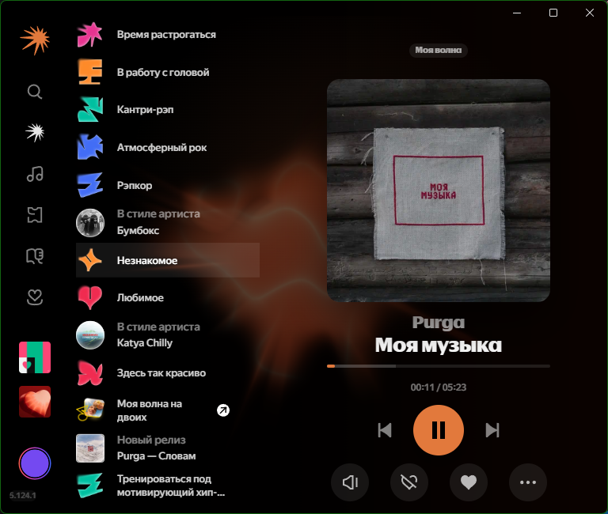

# ym-theme

Неофициальная тема для десктопного приложения **Яндекс Музыка** (Windows,
Electron): свои цвета, типографика, скругления и переработанная страница
«Моя волна». Плюс возврат размера окна после перезапуска.

Проект не связан с Яндексом. Меняется только оформление локального клиента:
тема работает на вашей официальной подписке, ничего не скачивает и не
обходит ограничения сервиса.



> **Дисклеймер.** Инструмент патчит локальную установку приложения, из-за чего
> цифровая подпись exe перестаёт быть валидной. Используйте на свой риск:
> подробности в [DISCLAIMER.md](DISCLAIMER.md). Лицензия — [MIT](LICENSE).

---

## Требования и ограничения

**Требуется:**

| Что | Версия | Зачем |
| --- | --- | --- |
| Windows | 10 / 11, x64 | скрипты и пути рассчитаны на Windows |
| Яндекс Музыка (десктоп) | проверено на **5.124.1** | тема ставится в установленное приложение |
| Python | **3.8+** в `PATH` | сборка `app.asar` и пересчёт хеша exe (`apply`, `status`) |
| PowerShell | 5.1+ (встроен в Windows) | скрипты установки |

Python нужен только для установки и обновления патча. Для работы самой темы
он не требуется: приложение читает готовые CSS-файлы.

**Ограничения:**

- **Поддерживается одна версия приложения.** Патч завязан на структуру
  `app.asar` и на включённую проверку целостности в конкретной сборке.
  На других версиях возможны расхождения — тогда нужен `apply.ps1` из
  свежего релиза проекта или правка скриптов.
- **Подпись exe становится невалидной.** Антивирус и SmartScreen могут
  ругаться на изменённый бинарник. Откат — `scripts\restore.ps1`.
- **Обновление Музыки сбрасывает патч.** После обновления нужно снова
  запустить `apply.ps1`.
- **Только оформление.** Тема не влияет на аккаунт, подписку, звук и
  содержимое; не обходит ограничения сервиса.
- **Windows-only.** Скрипты для macOS/Linux не предусмотрены; CSS сам по себе
  переносим, но патчер — нет.
- **Хрупкость селекторов.** Классы приложения содержат хеш сборки, поэтому
  тема держится за `[class*='…']` и `data-test-id`; при крупных редизайнах
  отдельные правила могут перестать применяться.
- Внутренние имена (`YaMusicCustom` в коде, `custom-theme.log`) остались
  историческими — на работу не влияют.

---

## Что уже сделано

- **Палитра.** Приложение рисует интерфейс через CSS-переменные `--ym-*`
  (цвета, радиусы, отступы, тени, шрифты). Тема переопределяет их —
  меняется весь интерфейс сразу, без правки сотни стилей.
- **«Моя волна» — классический плеер.** Вместо огромного имени артиста,
  его фото и подписи трека внутри полосы: большая обложка, ниже исполнитель
  и название, полоса воспроизведения с таймкодами и кнопки.
  Колесо жанров осталось, но стало обычным вертикальным списком поуже.
- **Скрыто лишнее:** комментарии нейросети, огромное фото артиста,
  «вайбовая» анимация-клякса.
- **Размер окна запоминается.** Позиция и размер сохраняются в
  `%APPDATA%\YandexMusic\window-bounds.json` и восстанавливаются при запуске.
- **Горячая перезагрузка.** Правите CSS — окно перерисовывается сразу,
  без перезапуска приложения.
- **Ctrl+Alt+T** — быстро выключить/включить тему для сравнения.

## Как это устроено

```
Ваш CSS  ──►  src/loader.js  ──►  index.js внутри app.asar  ──►  webContents.insertCSS()
```

1. В `resources\app.asar` дописывается загрузчик (`src/loader.js`) в конец
   главного процесса `index.js`.
2. Загрузчик на каждый документ читает все `*.css` из активной папки темы
   (`theme_live` в проекте либо копия рядом с приложением) и вставляет их
   в окно через `webContents.insertCSS`.
3. Ничего не «взломано»: приложение просто получает пользовательский стиль
   поверх штатного.

### Почему пришлось трогать exe

В этой сборке включена проверка целостности asar: Electron сверяет SHA-256
заголовка `app.asar` со строкой, вшитой в `Яндекс Музыка.exe`. Поэтому скрипт
установки пересчитывает этот хеш в exe (64 байта по известному смещению).
Оригинальный exe сохраняется рядом как `Яндекс Музыка.exe.orig`.

Побочный эффект: цифровая подпись exe Яндекса перестаёт быть валидной.
Windows это не мешает запускать приложение, но антивирус может
отреагировать. Откат — `scripts\restore.ps1`, он вернёт оба файла.

---

## Быстрый старт

```powershell
# поставить / обновить тему (закроет и перезапустит приложение)
powershell -ExecutionPolicy Bypass -File .\scripts\apply.ps1

# проверить состояние
powershell -ExecutionPolicy Bypass -File .\scripts\status.ps1

# вернуть как было
powershell -ExecutionPolicy Bypass -File .\scripts\restore.ps1
```

`apply.ps1` копирует `theme\` в папку приложения — после этого проект можно
удалить, тема останется. Если тему нужно ещё поправить, есть режим живой
отладки: `live-start.ps1` → правим `theme_live\` → `live-stop.ps1`
(подробности ниже).

---

## Файлы темы

| Файл | Что делает |
| --- | --- |
| `theme\00-palette.css` | палитра: акцент, поверхности, слайдеры, радиусы |
| `theme\20-wave.css` | страница «Моя волна»: сетка классического плеера, список жанров |
| `theme\custom.js` | необязательный JS, если возможностей CSS не хватает |

### Откуда приложение берёт тему

Порядок поиска жёстко зафиксирован, чтобы не было путаницы «какие файлы
сейчас работают»:

1. `<проект>\theme_live` — **только для живой отладки**, если папка существует;
2. `<установка>\theme` — копия, которую `apply.ps1` кладёт рядом с приложением.

Папка `theme` в проекте **во время работы приложения не читается** — это
источник (то, что лежит в git). `apply.ps1` копирует её в `<установка>\theme`
и прописывает оба пути в `app.asar`.

Отсюда:

- после `apply.ps1` проект можно удалить — приложение продолжит брать тему
  из своей папки `C:\Users\<вы>\AppData\Local\Programs\YandexMusic\theme`;
- перенесли проект в другое место — запустите `apply.ps1` ещё раз (он
  прописывает новые пути);
- `restore.ps1` возвращает файлы приложения и удаляет копию темы у него.

### Живая отладка (`theme_live`)

Для оперативных правок, чтобы не гонять `apply` с перезапуском:

```powershell
# 1. включить: theme -> theme_live, приложение переключится на неё само (~2 с)
powershell -ExecutionPolicy Bypass -File .\scripts\live-start.ps1

# 2. править файлы в theme_live — изменения видны сразу
# 3. выключить: theme_live -> theme и -> копия у приложения, live удаляется
powershell -ExecutionPolicy Bypass -File .\scripts\live-stop.ps1
```

`live-start` ничего не запускает и не перезапускает: загрузчик сам замечает
появившуюся `theme_live` и переключается. `live-stop`, наоборот, переносит
изменения в `theme` (источник) и в копию у приложения, после чего удаляет
`theme_live` — приложение возвращается к копии.

**Какие файлы подхватываются (в активной папке):**

- все файлы с расширением `.css` **в корне** папки (в подпапках — нет);
  имена любые, в том числе `мой-стиль.css`;
- читаются по алфавиту и склеиваются в одну таблицу стилей: сначала
  `00-palette.css`, потом `20-wave.css`, потом ваши `30-…`, `99-…`.
  При равной специфичности селекторов побеждает то, что идёт ниже, то есть
  файл с «большим» именем. Нумерация в именах — это и есть порядок;
- можно держать всё в одном файле — тоже работает;
- `custom.js` — единственное имя для JS: другие `.js` не читаются.
  Выполняется на каждой странице, ошибки ловятся и пишутся в лог;
- BOM в начале файла (его ставит, например, PowerShell) срезается
  автоматически — сохранять можно любым редактором.

**Правки на лету.** Сохранили, добавили или удалили `.css` — окно
перерисовывается примерно через 0,2 с.

**Как убедиться, что тема подхватилась.** В логе
`%APPDATA%\YandexMusic\custom-theme.log` видно, какая папка активна:

```
theme dir: C:\Users\...\YandexMusic\theme
watching:  C:\Users\...\YandexMusic\theme
apply: css=18223 chars
apply: inserted key=1
```

`theme dir:` и `watching:` показывают, откуда читается тема сейчас. Если там
`readCss: theme dir not found` — обе папки отсутствуют, `apply: css empty` —
папка есть, но в ней нет `.css`.

### Полезные селекторы

У Музыки имена классов содержат хеш сборки (`VibePage_meta__kWwRE`) и меняются
с обновлениями. Поэтому в теме используются устойчивые префиксы и `data-test-id`:

```css
[class*='VibePage_root']          /* вся страница «Моя волна» */
[data-test-id='VIBE_PLAYERBAR']   /* плеер на этой странице */
[data-test-id='PLAY_BUTTON']      /* кнопка play */
[data-test-id='WHEEL_ITEM_TITLE'] /* подпись жанра в списке */
```

### Отладка

DevTools в приложении не открывается, но можно запустить его с портом:

```powershell
& "$env:LOCALAPPDATA\Programs\YandexMusic\Яндекс Музыка.exe" --remote-debugging-port=9222
node tools\cdp.mjs eval "document.title"
node tools\cdp.mjs shot screen.png
```

Лог загрузчика: `%APPDATA%\YandexMusic\custom-theme.log`.

---

## После обновления приложения

Яндекс Музыка обновляется сама и заменяет `app.asar` и exe. Тема при этом
перестанет применяться (приложение запустится как обычно). Лечится одним
запуском `scripts\apply.ps1` — он заметит новую версию, пересоздаст бэкапы,
заново скопирует тему к приложению и пересоберёт патч.

`scripts\restore.ps1` возвращает файлы приложения и удаляет копию темы
из папки приложения; папка `theme` в проекте остаётся нетронутой.

## Частые вопросы

**Нужен ли проект после установки?**
Нет. `apply.ps1` копирует тему в `...\Programs\YandexMusic\theme`, и
приложение читает уже её. Проект нужен только чтобы менять тему и
переустанавливать патч.

**Где приложение ищет тему?**
Сначала `<проект>\theme_live` (если существует — режим живой отладки), иначе
`<установка>\theme`. Папка `theme` в проекте при работе не читается.

**Что будет, если удалить `theme_live`?**
Приложение в течение ~2 секунд переключится на копию у себя. Ничего не
сломается.

**Можно ли менять CSS, пока играет музыка?**
Да, и это самый удобный режим: сохранили файл — через мгновение увидели
результат. Если что-то поехало, `Ctrl+Alt+T` выключает тему, чтобы сравнить
с оригиналом.

**Почему тема не применилась после переустановки/обновления Музыки?**
Обновление заменяет `app.asar`, вместе с ним пропадает и загрузчик темы.
Запустите `scripts\apply.ps1`.

---

## Структура проекта

```
scripts\      apply / restore / status / live-start / live-stop
src\loader.js загрузчик темы (дописывается в main-процесс)
theme\        источник темы (то, что лежит в git)
theme_live\   временная папка живой отладки (создаётся live-start)
tools\        сборка asar, патч хеша exe, CDP-клиент, извлечение CSS
reference\    распакованный оригинальный app.asar (для изучения селекторов)
```

Рядом с приложением после `apply.ps1` появляются:
`theme\` (копия темы), `resources\app.asar.orig` и `Яндекс Музыка.exe.orig`
(бэкапы для отката).

---

## Лицензия и правовая часть

Код проекта распространяется по лицензии [MIT](LICENSE).
Проект неофициальный, не связан с Яндексом и не содержит кода, ресурсов или
логотипов приложения — только собственные стили и скрипты, которые работают
с локально установленной копией. Перед использованием прочитайте
[DISCLAIMER.md](DISCLAIMER.md).
